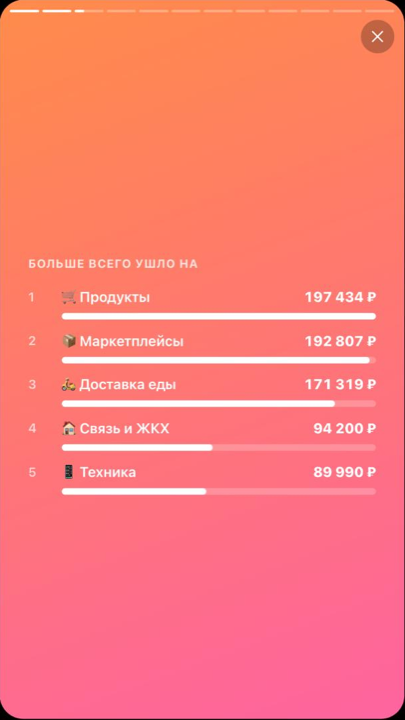
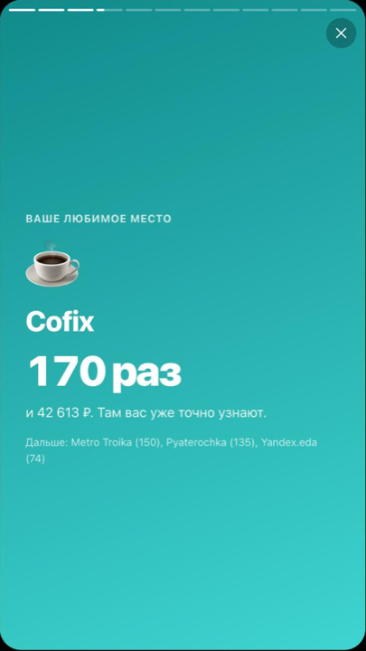
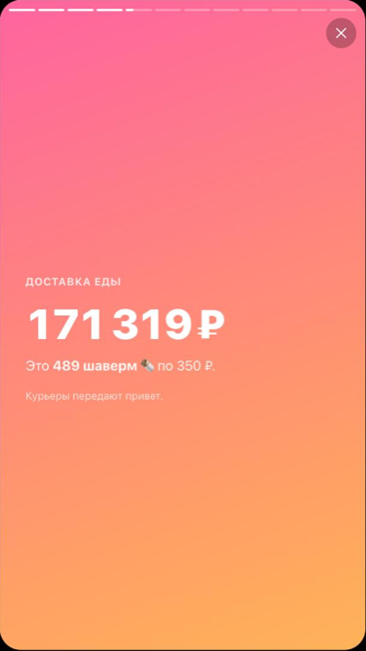
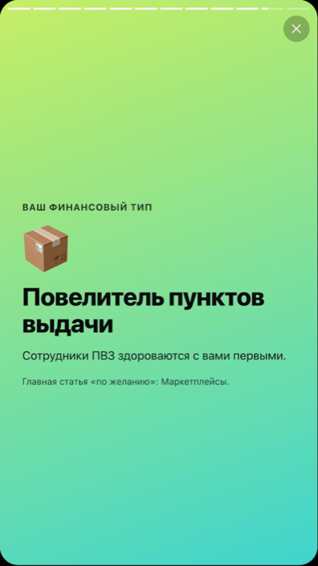
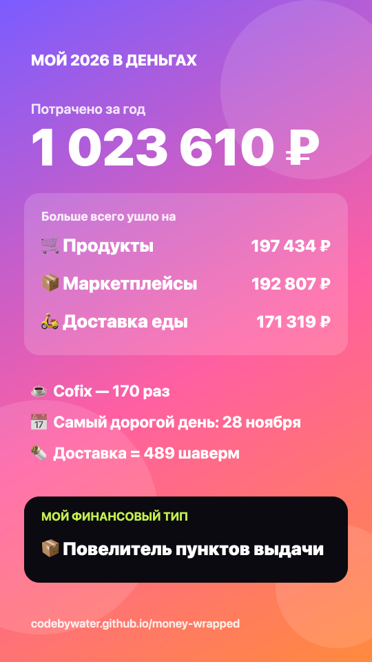

# 🎁 Мой год в деньгах

[](https://github.com/codebywater/money-wrapped/actions/workflows/tests.yml)


**Итоги года по банковской выписке в стиле Spotify Wrapped.** Загружаете CSV из банка и смотрите сторис о своём годе: сколько потратили, на что ушло больше всего, любимое место, самый дорогой день, сколько шаверм стоила доставка и какой у вас финансовый тип. В конце получаете картинку для сторис.

### 👉 [Посмотреть свой год](https://codebywater.github.io/money-wrapped/) — или нажмите «Посмотреть на примере»

<p align="center">
  
  
  
  
</p>
<p align="center">
  
  <br><sub>Слайды и картинка-итог на демо-выписке вымышленного человека</sub>
</p>

**Выписка не покидает ваше устройство.** Всё считается в браузере, а странице запрещено отправлять что-либо в интернет: это закреплено политикой безопасности (CSP), проверить можно в [исходном коде](docs/index.html). Картинка-итог тоже рисуется у вас.

> **English summary.** A "Spotify Wrapped" for your bank statement. Drop a CSV from a Russian bank and get a story-style recap of your year: total spent, top categories, favourite place, most expensive day, food delivery converted to shawarmas, subscriptions, and your spending persona, plus a 1080×1920 share card. Runs entirely in the browser; nothing leaves your device.

## Что внутри

| Слайд | Пример |
|---|---|
| 💸 Сколько потрачено за год | «1 023 610 ₽, 905 покупок — в среднем 2 804 ₽ в день» |
| 🏆 Топ-5 категорий | Продукты, маркетплейсы, доставка, такси, кофе… |
| ☕ Любимое место | «Cofix — 170 раз» |
| 🌯 Доставка в шавермах | «171 319 ₽ — это 489 шаверм» |
| 📅 Самый дорогой день и покупка года | «28 ноября — 91 334 ₽» |
| 📊 Самый транжирный месяц | график по месяцам и любимый день недели для трат |
| 📺 Подписки | регулярные списания одной суммой и сколько они стоят в год |
| 🌙 Ночная жизнь | покупки после 23:00 (если в выписке есть время) |
| 🎭 Финансовый тип | «Король доставки», «Гаджетоман», «Повелитель пунктов выдачи»… |
| 📲 Картинка для сторис | 1080×1920, сохраняется или отправляется через «Поделиться» |

Цифры в примере — из демо-выписки вымышленного человека.

## Как получить выписку

В приложении или интернет-банке найдите «Выписка» или «История операций», выберите период с 1 января и формат **CSV** (или Excel, а потом сохраните как CSV). Подойдут выписки Сбера, Т-Банка, Альфа-Банка, ВТБ и других: колонки с датой, суммой и описанием определяются автоматически, кодировки UTF-8 и Windows-1251 тоже.

Если ваш банк выгружает выписку так, что страница её не читает, [создайте issue](../../issues/new) с заголовками колонок (без самих операций).

## Как это работает

- **Категории** определяются по названию продавца: 17 групп и больше 200 шаблонов для российских магазинов и сервисов, в том числе в латинице («PYATEROCHKA», «YANDEX.EDA»). Если банк сам указал категорию, она тоже учитывается.
- **Переводы между своими счетами** не считаются тратами.
- **Подписки** — одно и то же место минимум в трёх разных месяцах с суммой, которая отличается не больше чем на 15%. Коммуналка и связь в подписки не попадают.
- **Финансовый тип** выбирается по самой большой категории, кроме продуктов, коммуналки и переводов: они есть у всех.

Ядро — [docs/wrapped.js](docs/wrapped.js), сторис — [docs/app.js](docs/app.js), картинка — [docs/share.js](docs/share.js). Зависимостей нет.

```bash
git clone https://github.com/codebywater/money-wrapped
cd money-wrapped
npm test                         # тесты на встроенном node:test
python3 -m http.server -d docs   # открыть на http://localhost:8000
```

Новые магазины и категории — самый простой способ помочь: добавьте шаблон в `CATEGORIES` в [docs/wrapped.js](docs/wrapped.js) и тест в [tests/wrapped.test.js](tests/wrapped.test.js).

## От того же автора

- [subscription-hunter](https://github.com/codebywater/subscription-hunter) — найдёт забытые подписки и поможет их отменить;
- [nalog-helper](https://github.com/codebywater/nalog-helper) — сколько налогов платить ИП и самозанятому по той же выписке.

## Лицензия

MIT
